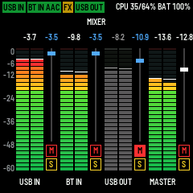
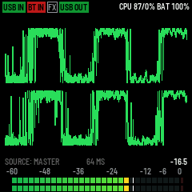
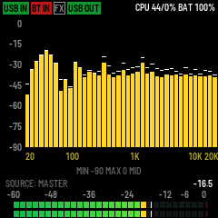
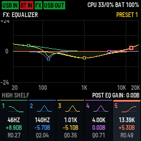
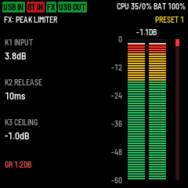

<h1 align="center">FM Interface</h1>

  USB audio interface and Bluetooth receiver for the M-VAVE FM-1, with a MIDI sequencer and arpeggiator.
  Based on FM-1 Audio Router.

  
  
  
  
  

  
  
  

# Features
- 2in/2out 16/44100 USB audio interface
- Bluetooth audio receiver with SBC, AAC, aptX, aptX HD and LDAC support
- FX chain of 5 bands parametric EQ and peak limiter with 8 presets
- Mixer
- MIDI controller functionality
- 4 visualizers: meters, waveforms, 40-band spectrum and vectorscope
- 4-track MIDI sequencer and arpeggiator
- Retrospective MIDI capture, including the Melodee nightly free take that detects BPM

The equalizer stays. The sequencer is MIDI, so it does not use the EQ's audio buffers. The limiter and the rest of the router are unchanged.

# Installation
1. Flash m-bootloader with [M-Flasher](https://github.com/jvitkauskas/m-flasher)
2. Turn off FM-1 and turn on while holding **REC** button
3. Flash [latest firmware](https://github.com/maxravedj/fm1-audio-router/releases/latest/download/fm1-audio-router-v0.5.0.fwsc) with M-Flasher

See additional [installation instructions](docs/INSTALL.md)

# Usage and controls
### USB audio
Plug your FM-1 to computer and it should be deteceted as class compliant 2in/2out audio interface. Incoming audio will be played through speaker or headphones output. You can send audio back to computer using USB OUT feature to have loopback or pass incoming bluetooth audio feed, raw or post-FX.

### Bluetooth
Enable bluetooth in settings and hold **OCT+** to enter or exit pairing mode. BT badge in status bar is yellow during pairing mode.

### FX chain
Hold **FX** button to enable or disable FX chain. Press **SEL** on specific FX screen to bypass that FX
- EQ: use **SELECT** to cycle through five bands and post-EQ gain, **ALGORITHM** to select filter type, **K1** for frequency, **K2** for gain or slope, **K3** for Q or resonance
- Peak limiter: use **K1** for input gain, **K2** for release, **K3** for ceiling

Use **PRESETS** knob to scroll presets. EQ and limiter have 8 preset slots each. Use **SAVE** to store changes to current preset.

### Mixer
Press **GLO** to open mixer. Use **K1**-**K3** to trim volumes on inputs and USB output. Use **MASTER** knob to control Master volume. Press **PLAY/STOP** to mute Master (works on any screen).
Use **F3**/**G3**/**A3**/**B3** to mute and **F4**/**G4**/**A4**/**B4** to solo.

### Settings
Press **EDIT** to open settings, use **SELECT** to scroll, **ALGORITHM** to change parameters and **SAVE** to save and apply settings.
- Bluetooth: enable/disable bluetooth
- Bluetooth codecs: **SEL** opens a checklist; **SELECT** scrolls, **SEL** toggles, **OCT−** cancels and **OCT+** confirms the draft. Press **SAVE** in Settings to apply it.
- Waveform auto scale: automatically fit the selected USB IN, BT IN, USB OUT or MASTER waveform to the display.
- USB OUT: send audio back to USB, select source here.

### MIDI controller
Enable MIDI in settings.
With USB connected, press **REC** to enter or leave MIDI mode. Encoders send absolute CCs (0–127) with gentle acceleration; keys send notes. **OCT−/OCT+** shift up to three octaves; press both to reset. Leaving MIDI saves encoder positions and octave shift for the next boot. **MASTER** keeps controlling audio.

### Sequencer and arpeggiator
Press **SEQ** to open NOTES, the piano roll. Press it again for STEPS, PATTERN, then TEMPO. **ARP** opens the arpeggiator. **HOME** leaves either page. **PLAY/STOP** starts and stops the sequence on every page and does not mute the incoming audio. If the master was muted, **PLAY** or **REC** turns it back on. Mute and solo stay on the mixer page.

The roll shows 16 steps, and PATTERN extends the loop to 1, 2 or 4 bars (16, 32 or 64 steps). Stopped, on NOTES or STEPS, a key or chord writes the cursor step and releasing the keys advances. While playing, the keys only play. On PATTERN, TEMPO and ARP the keys play freely.

The sequencer and arpeggiator send USB MIDI on the channel chosen in Settings (channel 1 until you change it), plus MIDI clock, Start and Stop while the sequence runs.

Four MIDI tracks share one clock. **SELECT** chooses the track. On TEMPO, **K1** is BPM (40–240). On NOTES, **K1** and **PRESETS** move the step and **K2** changes pitch. **ALGORITHM** is the arpeggiator: OFF, UP, DN, UPDN, RND, ORD, REPEAT. **SEL** toggles arpeggiator hold. **OCT−/OCT+** shift the keys; press both to reset. A short **EDIT** on NOTES or STEPS clears the cursor step.

Notes leave on USB MIDI. Track 1 uses the MIDI channel from Settings; each next track uses the next channel.

Press **REC** to capture:

- **Stopped, empty pattern:** this is the free take from Melodee nightly `3fe570d`. Play in your own time, then hold **REC** on the next downbeat. The press ends the loop and it plays from the top. If the other tracks are empty, the tempo moves to the nearest BPM that makes the phrase 1, 2 or 4 bars. Within 3% of the current BPM it stays. One note, a press long after the last note, or notes already on another track keep the current tempo and the played timing. A rest longer than 8 seconds starts the phrase over. An external clock or an armed track does not take a tempo from what you played.
- **While the sequence is playing:** the last 1, 2 or 4 bars are written in. A pattern that already has notes keeps its length and records over that window.

Hold **EDIT** to undo the capture. A short **EDIT** on NOTES or STEPS clears the cursor step; on PATTERN or TEMPO it opens Settings. The captured loop is kept in RAM until power-off.

### Visualizers
Press **HOME** to open visualizers screen and cycle through different visualizers.
 - Meters: no controls
 - Waveforms: **SELECT** knob scrolls through audio sources to visualize, use **K1** to choose window size
 - Spectrum: **SELECT** for source, **K1** and **K2** for minimum and maximum displayed dB, **K3** controls decay rate
 - Vectorscope: **SELECT** for source; mono is vertical and out-of-phase stereo spreads horizontally. Change Vectorscope color in Settings.

AAC uses meters during playback to free decoder memory. LDAC supports stereo 44.1/48 kHz; spectrum yields memory first, and waveforms/vectorscope remain available when SRAM allows.

## Other usefull stuff

[Controls](docs/CONTROLS.md) · [Build, tests and releases](docs/BUILD.md) ·
[Architecture](docs/ARCHITECTURE.md) · [Debugging](DEBUG.md)

Built on fm1-base and felucca-bsp. See [credits](CREDITS.md) and
[licensing](LICENSING.md). Host tests cover DSP, protocols and UI behavior;
hardware RF interoperability, sound quality and CPU headroom need device checks.
